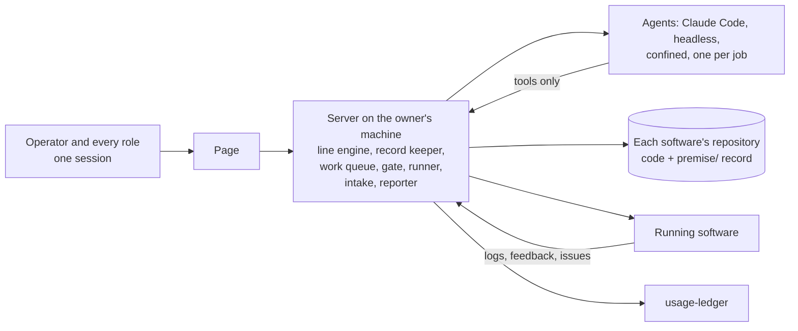

# premise

One product that takes software from an idea to running software, and keeps taking work back in, with LLMs doing everything an LLM can do.

- It is for someone who knows what the software is for. That is all the product requires of them.
- Every other person the software needs is also a user of the product, and is asked in their own terms at their step.
- If an LLM can do it, an LLM does it; return on effort decides, not perfection. If an LLM cannot reliably do it, it proposes and a person decides.

The full statement is in [VISION.md](VISION.md).

> **Status: being built.** The owner said to build the whole of premise ([0130](docs/decisions/0130-the-build-starts-and-covers-all-of-premise.md)). The foundation is in (configuration, storage, the work queue, a scripted agent used by tests and demos, a mock of usage-ledger, the setup check), so is the record keeper (each software's lasting record, its trace trailers and its own git repository), and so is the page with its server: start a software from an idea and walk it through the line (shown as three phases, [0165](docs/decisions/0165-the-page-shows-three-phases.md)). The runner (starts a built software from a clean copy, confined, on a local port, restarting it if it crashes) and the reporter (reports from recorded facts only, including what failed and what was not checked) are in too ([0162](docs/decisions/0162-how-the-runner-is-built.md)–[0164](docs/decisions/0164-how-the-reporter-is-built.md)). The real agent runner is in too: Claude Code run headless, each session confined by its sandbox, and on by default ([0180](-premise-uses-real-agents-by-default.md)). So are the line engine (Why, Who, What exists, What, Say back and Plan, run by agents) and the gate (premise asks before it acts outside this machine, including creating a repository on GitHub) ([0183](docs/decisions/0183-how-the-line-engine-is-built.md), [0182](-how-the-gate-is-built.md)). Build, Check and Intake are still a labelled scripted stand-in, and the line does not yet hand built software to the runner ([roadmap](docs/product/roadmap.md)). Questions that were open with the owner were chosen for the owner and can be corrected ([open questions](docs/open-questions.md)).

## Quick start

You need [Node.js](https://nodejs.org) 22.13 or later and git.

```sh
git clone https://github.com/omkarbhale/premise.git
cd premise
npm install
npm run build
npm start
```

`npm start` prints a link such as `http://localhost:4610/#token=…`. Open it in your browser and describe a software in a sentence or two; the page says what happens next. The link holds a private token; restarting premise gives a new one, and `npm run new-link` prints a new one at any time (older links stop working).

- **Agents are real by default.** They run as Claude Code sessions on your existing Claude Code login, with no API key ([0180](-premise-uses-real-agents-by-default.md)). On Linux and WSL2 they need Claude Code, bubblewrap and socat (`sudo apt install bubblewrap socat`), because every agent runs inside Claude Code's sandbox. If real agents cannot start, premise still starts, holds agent work, says on the page what is missing, and offers "look around with scripted agents (not real)". `npm run doctor` checks all of it.
- **To try it without calling an AI,** start with scripted agents: `npm run demo`, or `npm start -- --scripted`. Scripted agents are labelled on the page. Tests and CI always use them (`"agents": { "mode": "scripted" }`).
- **The later stages are a stand-in.** Build, Check, Run, Report and Intake are completed by a labelled scripted stand-in until they are built.
- **Usage figures are mocked** until usage-ledger exists, and the page labels them "Mocked".
- **Check your machine** with `npm run doctor`: it lists what premise needs, what is missing, and how to get it.
- **Change settings** (how many agents run at once, the model and effort for each type of task, and more) in `config.json` in the data folder (`~/.premise` by default), or with environment variables. Every setting: [configuration reference](docs/reference/configuration.md).
- Start on another port with `npm start -- --port 4700`, or use another data folder with `npm start -- --data <folder>`.

For working on premise: `npm run dev` (rebuilds the server on change), `npm test`, `npm run lint`, `npm run typecheck`. `npm test` needs the page built (`npm run build`) and Playwright's headless Chromium (`npx playwright install chromium-headless-shell`) for its one browser test, which saves screenshots of each main state in `test-artifacts/screenshots/`. Every change goes through the no-mistakes validation pipeline ([0131](docs/decisions/0131-changes-go-through-the-validation-pipeline.md)); CI runs the same checks.

## The code

One TypeScript package ([0075](docs/decisions/0075-one-package.md)):

| Folder | What it is | Specification |
| --- | --- | --- |
| `src/config/` | The settings: one list with defaults and checks, loaded from `config.json` and `PREMISE_*` variables | [configuration reference](docs/reference/configuration.md) |
| `src/storage/` | The SQLite database in the data folder, with numbered migrations | [storage](docs/specs/storage.md) |
| `src/queue/` | The work queue: jobs that survive a restart, the parallel limit, priority, the same-failure rule, the usage-limit pause | [work queue](docs/specs/work-queue.md) |
| `src/agents/` | The agent runner's interface; the scripted agent used by every test; real Claude Code sessions (confinement, limits, stop and resume); the tools agents reach premise through | [agent runner](docs/specs/agent-runner.md), [agent tools](docs/specs/agent-tools.md) |
| `src/usage-ledger/` | usage-ledger's interface, and its mock | [models and cost](docs/architecture/models-and-cost.md) |
| `src/record/` | The record keeper: the record's format, proposed changes, trace trailers, the reading API; `premise record check <folder>` | [record keeper](docs/specs/record-keeper.md) |
| `src/git/` | The one small module for git, and the repository host seam | [record keeper](docs/specs/record-keeper.md#54a-repositories) |
| `src/runner/` | The runner: starts a built software from a clean copy by its `run.md`, confined, on a local port; restarts it a few times when it crashes; shows the link or the command and the latest output | [runner](docs/specs/runner.md) |
| `src/reporter/` | The reporter: gathers recorded facts and builds the report (short by default, more on request), release-note drafts and milestone reports | [reporter](docs/specs/reporter.md) |
| `src/doctor/` | The setup check | [page server](docs/specs/page-server.md#51-prerequisites) |
| `src/server/` | The page server: the session token, Host and Origin checks, the API, the event stream, and the service interfaces the rest of premise answers | [page server](docs/specs/page-server.md) |
| `src/line/` | The line engine: work items, the stages Why to Plan run by agent jobs with briefs from `docs/prompts`, and a labelled stand-in for the later stages | [line engine](docs/specs/line-engine.md), [0183](docs/decisions/0183-how-the-line-engine-is-built.md), [0181](-the-line-works-on-work-items.md) |
| `src/gate/` | The gate: asks before a floor action, approvals (once, or a kind for one software), declines | [gate](docs/specs/gate.md), [0182](-how-the-gate-is-built.md) |
| `src/shared/` | The API's types and the stages, shared by the server and the page | |
| `web/` | The page (React, built with Vite), and its component tests | [page](docs/specs/page.md) |
| `test/` | Vitest tests, and one headless browser test; none calls an LLM or the network. Real agents are tested against a stand-in `claude` that replays recorded events; one real session is opt-in only | |

## The problem

- **The line from an idea to running software is held together by hand.** Before premise, the owner's loop from intent to a deployed change existed, as the assistant described it, "in pieces held together by hand", and broke at the hand-carried joins ([how we work](docs/how-we-work.md#why-premise-is-being-made)).
- **Nothing covers the whole line.** The prior-art research found tools crowded around building, spec checkpoints and code review, and thin or absent where premise cares most: deciding what to build, bringing in several people at their own steps, reporting, cost against value, and keeping rejected alternatives ([report](docs/prior-art/report.md)).
- **The big mistake is building the wrong thing.** Intent mismatch is the top reported failure: agents guess rather than ask.
- **People's attention is the bottleneck,** not build speed. Every question and report costs the scarcest thing.
- **Checks and reports are only as good as their independence.** Agents game checks they can reach, and self-reports have been false.

## Key capabilities

- **The whole line in one product.** Why, Who, What exists, What, Say back, Plan, Build, Check, Run, Report, Intake. No step where a person carries work to an LLM by hand ([the line](docs/architecture/the-line.md)).
- **Drafts first, people correct.** premise drafts each stage as a short list and shows its assumptions; it asks only where being wrong is costly ([0027](docs/decisions/0027-spend-least-of-peoples-attention.md)).
- **Looks at what exists before building,** and may recommend not building at all ([0023](docs/decisions/0023-looking-at-what-exists.md)).
- **Says back what it understood** as at most ten items to strike out ([0028](docs/decisions/0028-say-back-as-assumptions-to-strike.md)).
- **Makes the technical decisions itself,** each recorded with its reason and the alternative rejected; foundation choices get a second agent's review.
- **Builds unattended, checks independently.** The checker never sees the builder's account and keeps its scenarios out of the builder's reach ([build, check and run](docs/architecture/build-check-run.md)).
- **Ends at running software** people can open: a link, a command and its output, or a built program ([0017](docs/decisions/0017-the-line-ends-at-running-software.md)).
- **A lasting record in each software's repository,** one item per line, every commit traced to the items it serves ([the record](docs/architecture/the-record.md)).
- **Every role in one session,** each ask labelled with the role it is for and phrased in that role's terms ([0065](docs/decisions/0065-one-open-session.md)).
- **Intake that goes in normally,** with only what needs holding held and read together ([intake and reporting](docs/architecture/intake-and-reporting.md)).
- **Honest reports** from recorded facts only, every line linked to its evidence ([0097](docs/decisions/0097-reports-from-recorded-facts.md)).
- **A floor never traded for speed,** enforced by confinement and a gate, not by instructions ([the floor and the gate](docs/architecture/the-floor-and-the-gate.md)).
- **Cost per piece of work** through usage-ledger ([models and cost](docs/architecture/models-and-cost.md)).

## How it works



Simplified view; see the [architecture overview](docs/architecture/overview.md) for every part.

- People use premise through one browser page holding one session where everything is open.
- The server, one process on the owner's machine, moves each software along the line, asks in the session, and runs agents for the work: drafting, research, review, planning, building, checking, triage, readings and reports.
- Agents hold no credentials. They reach premise only through the tools their role gets, cannot write the record or push, and run confined. The server keeps the record, pushes, runs the software and passes every floor action through the gate.
- The checked software runs from a clean copy; what comes back from it and from people is intake, judged against the record.

## Scope summary

| Category | Examples |
| --- | --- |
| In the product | The whole line; every role a software needs; taste claims; the lasting record and traces; honest reports; intake, automatic and held; existing software; cost per piece of work; what the software's users read; several softwares at once; other people setting premise up; any kind of software |
| First milestone | Proof of unattended LLM work on the owner's subscription; then the thinnest line, end to end, for a small command-line utility and a small web app; then usage-ledger, the owner's first software ([0137](docs/decisions/0137-first-software-is-usage-ledger.md)) |
| Not the product's job | Acting in the real world (opening accounts, paying, signing); selling or supporting the software; finding out on its own whether real people want the software |

Details: [scope](docs/product/scope.md); order: [roadmap](docs/product/roadmap.md).

## Documentation map

**Start here**
- [VISION.md](VISION.md): what premise is, who it is for, its principles, the line, the record, and what is not yet worked out. Stays at the root ([0111](docs/decisions/0111-vision-stays-at-the-root.md)).
- [Executive summary](docs/executive-summary.md): premise in two pages.
- [Glossary](docs/glossary.md): the words the documents use.
- [Open questions](docs/open-questions.md): what is still open, and the questions the assistant chose for the owner.
- [Configuration reference](docs/reference/configuration.md): every setting, its default and its meaning.

**Product**
- [Scope](docs/product/scope.md): what is in, what is not the product's job, what is not yet worked out.
- [Roles and use cases](docs/product/roles-and-use-cases.md): premise's roles and what each is asked.
- [Roadmap](docs/product/roadmap.md): the build order agreed with the owner, and the nine milestones.

**Architecture and decisions**
- [Architecture overview](docs/architecture/overview.md): the parts, how they talk, the risks.
- [Where premise runs and how people reach it](docs/architecture/where-it-runs.md)
- [The record](docs/architecture/the-record.md)
- [The line, stage by stage](docs/architecture/the-line.md)
- [Build, independent check and run](docs/architecture/build-check-run.md)
- [Intake, reporting and taste](docs/architecture/intake-and-reporting.md)
- [The floor and the gate](docs/architecture/the-floor-and-the-gate.md)
- [Models and cost](docs/architecture/models-and-cost.md)
- [Decision records](docs/decisions/README.md): every decision, one per file, grouped by theme, each saying who decided.

**Module specifications** ([index](docs/specs/README.md))
- [Page server](docs/specs/page-server.md), [page](docs/specs/page.md), [line engine](docs/specs/line-engine.md), [record keeper](docs/specs/record-keeper.md), [work queue](docs/specs/work-queue.md), [agent runner](docs/specs/agent-runner.md), [agent tools](docs/specs/agent-tools.md), [gate](docs/specs/gate.md), [runner](docs/specs/runner.md), [intake](docs/specs/intake.md), [reporter](docs/specs/reporter.md), [storage](docs/specs/storage.md).

**Prompts and skills**
- [Prompts](docs/prompts/README.md): the full text of every agent role's prompt and the fixed wording premise shows without a model.
- [Skills](docs/skills/README.md): the shared guidance every agent role loads.

**How premise is being made**
- [How we work](docs/how-we-work.md): why and how premise is being made, the working rules, the method, how changes ship, and the prior-art research.

**Raw history, never edited**
- [docs/record/conversation-2026-11-20.md](docs/record/conversation-2026-11-20.md): the whole conversation in order, both sides.
- [docs/record/conversation-2026-11-21.md](docs/record/conversation-2026-11-21.md): the exchange of 2026-11-21 in which the owner doubled back on the planning.
- [docs/record/shaping-notes-2026-11-20.md](docs/record/shaping-notes-2026-11-20.md): the assistant's running notes during the conversation.
- [docs/record/instruction-2026-11-21-build-starts.md](docs/record/instruction-2026-11-21-build-starts.md): the owner's instruction that started the build.
- [docs/record/subscription-sandbox-test-2026-11-21.md](docs/record/subscription-sandbox-test-2026-11-21.md): the first test of the plan, unattended Claude Code on the owner's subscription inside Claude Code's sandbox.
- [docs/record/scope-page-draft-0.1.html](docs/record/scope-page-draft-0.1.html): a review page drafted mid-conversation and later dropped in favour of the vision statement.
- [docs/prior-art/report.md](docs/prior-art/report.md): the prior-art research report.
- [docs/prior-art/ask.md](docs/prior-art/ask.md): what that research was asked to do.

## Licence

All rights reserved ([LICENSE](LICENSE), [0055](docs/decisions/0055-all-rights-reserved.md)).
