# Architecture overview

- **Status: being built,** starting with the foundation ([0130](../decisions/0130-the-build-starts-and-covers-all-of-premise.md)).
- Carved on 2026-11-21 from the plan for premise (old `docs/plan.md`), which was written the same day from [VISION.md](../../VISION.md) and the decisions.
- The plan was a working record ([0025](../decisions/0025-two-kinds-of-record.md)): detailed for building, not kept current afterwards. These documents carry it. When a choice here changes, the change is a new [decision record](../decisions/README.md) that supersedes the one it replaces.

## How to read the architecture documents

- Top-down: the parts and how they talk (this page); [where premise runs and how people reach it](where-it-runs.md); [the record](the-record.md); [the line, stage by stage](the-line.md); [build, check and run](build-check-run.md); [intake and reporting](intake-and-reporting.md); [the floor and the gate](the-floor-and-the-gate.md); [models and cost](models-and-cost.md). The milestones in order are in the [roadmap](../product/roadmap.md).
- Records 0001–0066 are decisions made by the owner or with the owner. Records 0067–0110 are the choices the plan numbered P1–P44: the owner did not make them; the builders did, each with its reason and the alternative rejected. Records 0111 onward are later builders' choices. Every record says who decided ([0112](../decisions/0112-record-numbering-keeps-old-entry-numbers.md)).
- The [module specifications](../specs/README.md) sit below these documents and say how each part behaves.
- Words:
  - the **product** is premise; the **software** is what premise builds;
  - the **operator** is the person who knows what a software is for;
  - an **agent** is one LLM session premise runs;
  - the **builders** are the agents that build premise itself.
  - More in the [glossary](../glossary.md).

## What the plan stays inside

Settled before the plan:
- One browser page: a chat, plus views of the record and of reports ([0044](../decisions/0044-one-browser-page.md)).
- premise is written in TypeScript ([0047](../decisions/0047-typescript.md)).
- It runs on the owner's machine first; hosting comes later, with other people setting it up ([0043](../decisions/0043-runs-on-the-owners-machine-first.md)).
- One session where everything is open, designed as if one person does everything; roles are labels on what is asked; no per-person links ([0065](../decisions/0065-one-open-session.md)). No accounts until other people set it up ([0045](../decisions/0045-a-link-per-person-no-accounts.md)).
- Any kind of software; no first kind ([0049](../decisions/0049-any-kind-of-software.md), [0057](../decisions/0057-vision-stays-any-software.md)).
- Each software in its own repository on the owner's GitHub; visibility per software or whatever GitHub says; premise enforces none ([0051](../decisions/0051-each-software-in-its-own-repository.md), [0059](../decisions/0059-repository-visibility-per-software.md)).
- The check is a different agent from the builder, out of its reach, judging the running result against the intent ([0030](../decisions/0030-independent-check.md)).
- Lasting records are kept current by the product as part of every change; working records are not maintained; a description of what exists is not maintained ([0025](../decisions/0025-two-kinds-of-record.md), [0026](../decisions/0026-no-maintained-description-of-what-exists.md)).
- Lists over long paragraphs ([0029](../decisions/0029-lists-over-long-paragraphs.md)).
- Nobody has to use another tool alongside premise; premise may be built on other tools underneath ([0063](../decisions/0063-premise-may-depend-on-other-tools.md)).
- Claude through the owner's subscription first; other providers later ([0046](../decisions/0046-claude-through-the-owners-subscription.md)).
- Cost tracking and the spending limit come from usage-ledger; premise builds none of its own ([0064](../decisions/0064-cost-and-spending-limit-from-usage-ledger.md)). Until usage-ledger exists its output is mocked, and the page says so ([0133](../decisions/0133-usage-ledger-is-mocked-until-it-exists.md)).
- The floor: losing data, security holes, spending money, acting publicly in someone's name, false reports ([0056](../decisions/0056-what-is-on-the-floor.md)).
- While premise is being built: work stops for the owner only on destructive, security-sensitive, public-facing or money-spending actions ([0053](../decisions/0053-when-work-stops-for-the-owner.md)); one short report per finished milestone ([0054](../decisions/0054-reports-to-the-owner.md)); changes go through the no-mistakes validation pipeline to pull requests the assistant merges ([0131](../decisions/0131-changes-go-through-the-validation-pipeline.md)); tests never use the owner's Claude login ([0134](../decisions/0134-the-owners-claude-login-only-when-strictly-necessary.md)).
- The owner said to build the whole of premise ([0130](../decisions/0130-the-build-starts-and-covers-all-of-premise.md)).

## The parts

```mermaid
flowchart LR
    P[People in one session<br/>operator and every role] --> PG[The page]
    PG -->|HTTP requests| PS[Page server]
    PS -->|server-sent events| PG
    subgraph S[The server: one Node.js process]
        PS --> LE[Line engine]
        LE --> WQ[(Work queue)]
        WQ --> AR[Agent runner]
        LE --> RK[Record keeper]
        LE --> GT[Gate]
        IN[Intake] --> LE
        RN[Runner] --> IN
        RP[Reporter]
    end
    AR --> AG[Agents<br/>Claude Code, headless,<br/>one child process each]
    AG -->|MCP tools, one token per session| S
    RK --> REPO[(Each software's repository<br/>on GitHub, premise/ folder)]
    GT --> REPO
    S --> DB[(SQLite and data folder<br/>on the owner's machine)]
    S --> UL[usage-ledger]
```

1. **The server.** One Node.js process on the owner's machine. Its modules:
   - **Page server:** serves the page and its API. [Spec](../specs/page-server.md).
   - **Line engine:** knows where each software is on the line, picks the next step, asks in the session, labelling each ask with its role. [Spec](../specs/line-engine.md).
   - **Record keeper:** the only writer of each software's lasting record; checks its format and its trace links. [Spec](../specs/record-keeper.md).
   - **Work queue:** jobs (draft, research, plan, build, check, run, report, triage, reading), stored so that a restart resumes them. [Spec](../specs/work-queue.md).
   - **Agent runner:** starts, watches and stops agent sessions; gives each its own working copy, confinement and limits. [Spec](../specs/agent-runner.md).
   - **Gate:** every action on the floor passes here; it asks in the session, under the role whose call it is, or lets the action through. [Spec](../specs/gate.md).
   - **Runner:** starts the built software from a clean copy and keeps it up while premise runs. [Spec](../specs/runner.md).
   - **Intake:** takes items in from every source and routes them. [Spec](../specs/intake.md).
   - **Reporter:** writes reports from recorded facts. [Spec](../specs/reporter.md).
2. **Agents.** Claude Code sessions run headless, one child process each. Each has a role (drafter, researcher, planner, builder, checker, triager, reporter), instructions that ship with premise, and only the tools its role needs.
   - Two more agent roles, reviewer and reader, were added later ([0113](../decisions/0113-agent-roles.md)). The [prompts](../prompts/README.md) and [skills](../skills/README.md) are their instructions; the [agent tools](../specs/agent-tools.md) are their tools.
3. **The page.** One browser page holding one session where everything is open: chat, every stage, record view, report view, and "needed", grouped by role ([0065](../decisions/0065-one-open-session.md)). [Spec](../specs/page.md).
4. **Storage.** premise's own database and data folder on the owner's machine; each software's repository on GitHub. [Spec](../specs/storage.md).
5. **Tools underneath** ([0063](../decisions/0063-premise-may-depend-on-other-tools.md)): Claude Code, git, the GitHub CLI and usage-ledger, driven by the server. People never have to use them alongside premise.

## How they talk

- Page to server: an HTTP request for every action; one server-sent event stream per open page for live updates.
- Inside the server: plain function calls. Anything that must survive a crash goes through the work queue's table.
- Server to agents: each agent is a child process whose streamed JSON events the server reads.
- Agents to premise: only through tools the server serves to that one session: read the record, propose a record change, ask a person, request a gated action, report progress. Agents cannot write the record, push, or reach another session's tools.
- Server to GitHub: only the server creates repositories, pushes and reads issues.
- Server to usage-ledger: the server records which task each agent session did, where usage-ledger reads it, and asks usage-ledger for usage and budget figures ([models and cost](models-and-cost.md)).

## Choices

The builders' choices for the parts and how they talk. Each record gives the reason and the rejected alternatives in full.

| Record | Choice | Why, in short |
| --- | --- | --- |
| [0067](../decisions/0067-one-process-agents-as-children.md) (P1) | One Node.js process holds every module; agents are its child processes. | One command starts premise on the owner's machine; nothing to wire together or keep in step. |
| [0068](../decisions/0068-fastify-on-node-lts.md) (P2) | The server uses Fastify on the current Node.js LTS. | Typed request validation is built in; Node.js is what Claude Code itself runs on. |
| [0069](../decisions/0069-react-and-vite-page.md) (P3) | The page is React, built with Vite, served by the server as static files. | The builders are LLM agents, most reliable on the most common stack. |
| [0070](../decisions/0070-http-and-server-sent-events.md) (P4) | Page and server talk by HTTP requests plus server-sent events. | Actions are plain requests; only updates flow the other way. |
| [0071](../decisions/0071-headless-claude-code-agents.md) (P5) | Agents are Claude Code run headless (`claude -p` with streamed JSON output), as child processes. | Claude Code's documented way to be scripted, on the owner's own subscription login; one process per agent makes limits, confinement and stopping simple. |
| [0072](../decisions/0072-sqlite-state.md) (P6) | premise keeps its own state in SQLite, in a data folder in the user's home directory (configurable). | One file, no database server; transactions keep the work queue safe across crashes. |
| [0073](../decisions/0073-mcp-tools-with-session-tokens.md) (P7) | The server serves each agent's tools over MCP, with a token per session. | Claude Code connects to MCP servers natively; the token binds every call to one session and one role. |
| [0074](../decisions/0074-two-agent-sessions-at-once.md) (P8) | At most two agent sessions run at once by default. | Every session draws on the same subscription limits. |
| [0075](../decisions/0075-one-package.md) (P9) | premise's code lives in this repository as one package: server, page, agent instructions, and the scripted demo runs. | One thing to install and version; instructions change with the code that uses them. |

## Where this can go wrong, and what meets it

The first four risks were raised on the [scope page draft](../record/scope-page-draft-0.1.html) and never discussed with the owner; the plan answered them with the rest.

- **The conversation turns into paperwork:** drafts instead of interviews; stage budgets ([0085](../decisions/0085-stage-effort-budgets.md)); a say-back of at most ten items.
- **A say-back that confirms the wrong thing:** the smallest running version first; the checker judging against the record ([0089](../decisions/0089-checker-in-a-fresh-session.md), [0090](../decisions/0090-scenarios-out-of-the-builders-reach.md)).
- **Existing software swallows the effort:** it comes early, in a thin form, after thin intake, and its fuller form later (milestone 6; [0171](../decisions/0171-existing-software-much-earlier-in-a-thin-form.md)).
- **The whole line is a lot:** the thinnest line first, one milestone at a time.
- **Agents gaming their checks:** scenarios out of the builder's reach ([0090](../decisions/0090-scenarios-out-of-the-builders-reach.md)); a checker that never sees the builder's claims ([0089](../decisions/0089-checker-in-a-fresh-session.md)).
- **Destructive actions:** no credentials for agents, confinement ([0087](../decisions/0087-agents-run-confined.md)), the gate ([0101](../decisions/0101-the-gate-asks-in-the-session.md)).
- **Noise drowning people:** triage ([0094](../decisions/0094-triager-reads-every-item.md)); only what needs a person reaches one; notices only when someone is needed ([0098](../decisions/0098-report-when-a-change-reaches-running.md), [0099](../decisions/0099-notices-in-the-session.md)).
- **Model changes breaking premise:** instructions about the line, not one model; tier aliases ([0105](../decisions/0105-tier-aliases.md)); one part that knows the runtime ([0107](../decisions/0107-one-part-knows-the-runtime.md)).
- **Records going stale:** the record changes in the same commit as the code ([0080](../decisions/0080-record-in-the-softwares-repository.md), [0083](../decisions/0083-trace-trailer-on-every-commit.md)); the record keeper refuses malformed changes.
- **Insecure defaults for operators who cannot judge them:** [0092](../decisions/0092-security-defaults.md), checked on every change.
