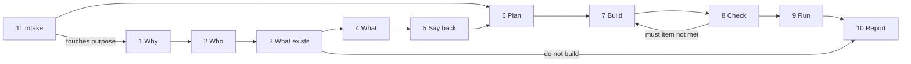

# The line, stage by stage

Carved from section 4 of the plan. Part of the [architecture](overview.md). Spec: [line engine](../specs/line-engine.md). Prompts: [drafter](../prompts/drafter.md), [researcher](../prompts/researcher.md), [planner](../prompts/planner.md), [reviewer](../prompts/reviewer.md).

The line is the one in the [vision](../../VISION.md#the-line): Why, Who, What exists, What, Say back, Plan, Build, Check, Run, Report, Intake. The whole line is the product; no step has a person carrying work to an LLM by hand ([0010](../decisions/0010-the-whole-line-is-the-product.md)).

## Rules for every stage

- premise drafts first and people correct ([0027](../decisions/0027-spend-least-of-peoples-attention.md)). A question is asked only when being wrong is costly.
- Each question is labelled with the role it is for, in that role's terms, and asked in the one session ([0065](../decisions/0065-one-open-session.md)).
- Every output is a short list. Each item can be struck, kept or edited on the page, one at a time.
- A software moves on when the stage's exit condition holds. The operator can send it back to any stage.
- [0085](../decisions/0085-stage-effort-budgets.md) (P19): each stage has an effort budget sized to the software; a small software gets short stages.
  - Why: depth follows return on effort ([0006](../decisions/0006-llm-does-what-it-can.md)), and a long conversation up front is the scope page's first risk.
  - Rejected: the same full depth for every software.
  - How the size is set: three size classes, proposed at Why as an assumption ([0117](../decisions/0117-size-classes-set-stage-budgets.md)).
- Who answers what is [0084](../decisions/0084-who-has-the-last-word.md) (P18), in [the record](the-record.md#keeping-it-true). How chat is told apart from answers is [0118](../decisions/0118-how-chat-messages-are-routed.md).

## The stages

1. **Why.**
   - premise asks the operator once what the software is for, in the operator's own words.
   - It drafts the problem as three to seven items. The operator strikes or edits.
   - Exit: the operator has seen the list and nothing struck is left open. Writes `why.md`.
2. **Who.**
   - premise drafts plausible kinds of user, and the roles the software needs: people with taste in a part, people who decide or do what an LLM cannot.
   - The operator corrects the list.
   - The roles become the labels on what premise asks from then on ([0065](../decisions/0065-one-open-session.md)). Writes `who.md`.
3. **What exists.**
   - The researcher agent searches the web and reads sources, within its budget ([0085](../decisions/0085-stage-effort-budgets.md)).
   - It lists what exists, with sources, and recommends one outcome: do not build, build on something, or build something different. It reads the motive from Why: saving effort, or finding a gap ([0023](../decisions/0023-looking-at-what-exists.md)).
   - The operator decides the outcome. "Do not build" ends the line with a report.
   - It repeats at a smaller size before a large feature or a foundation choice. Writes `exists.md`.
4. **What.**
   - premise drafts what the software must do, in purpose terms, with priorities. It offers its own ideas, marked as suggestions, and asks only where being wrong is costly.
   - People claim areas for their taste here ([taste](intake-and-reporting.md#taste-0022)). Writes `what.md` and `taste.md`.
5. **Say back.**
   - A list of at most ten items: what premise understood and assumed, in purpose terms, with assumptions marked ([0028](../decisions/0028-say-back-as-assumptions-to-strike.md)).
   - The operator strikes what is wrong; each struck item goes back to its stage.
   - When ([0020](../decisions/0020-when-to-say-back.md)): at the start of a new software; on taking on an existing one; later, for a change that replaces a `Y` or `U` item, a must item or a foundation decision, or that is costly to undo.
   - It is only the cheap first check. Running software shown early is the real one, so the plan's first task is always the smallest version that runs.
6. **Plan.**
   - The planner agent makes the technical decisions, each a `D` item with its reason and the alternative rejected.
   - Foundation decisions (language, framework, storage, how it runs, data model, who can get in) get a small "what exists" look and a review by a second agent before building ([0014](../decisions/0014-guard-against-further-big-mistakes.md): a wrong early foundation). The second agent is the reviewer ([0113](../decisions/0113-agent-roles.md)).
   - The security defaults apply ([0092](../decisions/0092-security-defaults.md)).
   - It writes a working plan: ordered tasks, each naming its items and small enough to check. The first task is the smallest version that runs.
7. **Build.** Unattended. [Build, check and run](build-check-run.md#build).
8. **Check.** [Build, check and run](build-check-run.md#check-0030).
9. **Run.** [Build, check and run](build-check-run.md#run).
10. **Report.** [Intake and reporting](intake-and-reporting.md#reporting).
11. **Intake.** [Intake and reporting](intake-and-reporting.md#intake-sources).

## Work of any size

Any piece of work goes through this same line at its own size: a software, a milestone, a module or an intake item ([0168](../decisions/0168-any-piece-of-work-goes-through-the-same-line-at-its-own-size.md)). Sizing picks the stages a piece needs and how deep each goes ([0117](../decisions/0117-size-classes-set-stage-budgets.md)).
- A piece may be split into parts that go through the line separately only when the parts are completely separate, or a part is very long. One heavy piece of work is not by itself a reason. Each split is recorded with its reason, and there are no several agents per stage by default ([0170](../decisions/0170-what-may-be-split-is-decided-by-strong-prompting.md)).
- As built: a sizer agent sizes each piece before its first stage, under rules it cannot break (every piece is built and checked; a new software always goes through Why, What, the say-back and Plan). A split piece's parts go through the line one after another, up to Check; then the whole is checked, run and reported. A plan's milestones are the software's parts. The operator can change any of it on the Line tab ([0184](../decisions/0184-how-sizing-of-work-is-built.md)).
- For each software, premise works out how to build, run and check it, keeps that in the record, and corrects it through intake. Where it cannot operate the software it reports "could not check" and names what is needed ([0167](../decisions/0167-premise-adapts-at-runtime-to-the-software.md)).
- A first pass need not be perfect; what is found comes back as intake ([0169](../decisions/0169-a-first-pass-need-not-be-perfect.md)).
- Splitting into child items is not built yet ([issue 58](https://github.com/omkarbhale/premise/issues/58)).

## Existing software (milestone 6)

Existing software enters the same line ([0019](../decisions/0019-existing-software-through-the-same-line.md)). It comes early, in a thin form: the record drafted from the code, people striking what is wrong, and changes from then on as intake ([0171](../decisions/0171-existing-software-much-earlier-in-a-thin-form.md)); the rest of what follows is built later ([roadmap](../product/roadmap.md)).

- An agent drafts the record from the code, its documentation, its history and its issues. Every item is marked `recovered`. The agent is the drafter, with its recovery brief ([0113](../decisions/0113-agent-roles.md), [drafter prompt](../prompts/drafter.md)).
- Parts that conflict, or cannot be inferred, become questions, each labelled with the role it is for ([0019](../decisions/0019-existing-software-through-the-same-line.md)).
- The say-back covers the whole recovered record. Recovered items stay unconfirmed until it passes; the prior art found that recovered intent misses 44–65% of user goals.
- "What exists" also asks whether something has appeared that makes part of the software unnecessary ([0023](../decisions/0023-looking-at-what-exists.md)).
- From then on every commit traces to items. Old code gets best-guess links, marked as guesses.
