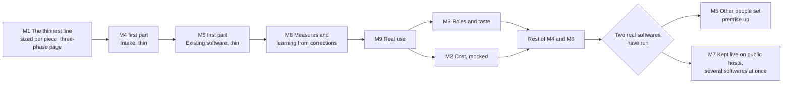

# Roadmap

The milestones, carved from section 8 of the plan, and the build order agreed with the owner. No dates are given. **The build has started and covers every milestone below, in this order** ([0130](../decisions/0130-the-build-starts-and-covers-all-of-premise.md), which supersedes [0061](../decisions/0061-nothing-built-until-the-owner-says.md)).

The vision states the vision only, with no now-or-later split ([0035](../decisions/0035-the-vision-states-the-vision-only.md)). The order is kept here.

## The order, plainly

The order of building, after the owner's decisions of 2026-11-21 ([0179](../decisions/0179-the-roadmap-is-reordered.md)):

1. **Milestone 1:** the thinnest line, now including work sized per piece and the three-phase page.
2. **Intake, in a thin form** (the first part of milestone 4).
3. **Existing software, in a thin form** (the first part of milestone 6).
4. **The measures, and learning from corrections** (milestone 8).
5. **Real use** (milestone 9).
6. **Roles and taste** (milestone 3) **and cost, mocked** (milestone 2). The rest of milestones 4 and 6 is finished with them.
7. **Last, after two real softwares have run through premise:** other people setting premise up, with hosting and accounts (milestone 5), and keeping software live on public hosts (milestone 7).

Milestone numbers keep the numbers they had, so the milestones below are in this order, not in number order. Real use starts as soon as milestone 1 runs, whatever comes next in the list ([0175](../decisions/0175-premise-is-used-for-real-as-soon-as-milestone-1-runs.md)).

## Build order agreed with the owner

- The owner said to build the whole of premise ([0130](../decisions/0130-the-build-starts-and-covers-all-of-premise.md)). It is built as a series of tasks; the first is the foundation: the package, configuration, storage, the work queue, the agent runner's seam with a scripted agent, usage-ledger's seam with a mock, and the setup check.
- First proof: the thinnest line, end to end, for any small software ([0034](../decisions/0034-first-proof-new-software.md), [0049](../decisions/0049-any-kind-of-software.md)). Its first step proves that premise can drive LLM work unattended through the owner's subscription; if that cannot be proven, work stops for the owner there.
- The first software is the owner's pick, made when the owner wants ([0050](../decisions/0050-first-software-is-the-owners-pick.md)). It is one the owner actually needs, and it goes through premise as early as possible, before the later milestones are built; milestone 1 does not wait for the pick, and the two sample softwares stay as extra proof ([0127](../decisions/0127-first-software-is-one-the-owner-needs.md), which adjusts [0060](../decisions/0060-first-software-does-not-hold-up-premise.md) and [0110](../decisions/0110-two-sample-softwares.md)). Chosen for the owner: usage-ledger, run with real agents when the owner allows it ([0137](../decisions/0137-first-software-is-usage-ledger.md)).
- Per software, the owner can set how much effort it gets and milestones to wait after ([0128](../decisions/0128-effort-per-software-and-milestone-waits.md)). Where each is built, open to the owner's correction: waits in milestone 1, and a priority field on each software from milestone 1 that orders the work queue ([0129](../decisions/0129-builders-reading-of-effort-and-milestone-waits.md), [0138](../decisions/0138-priority-is-a-field-from-milestone-1.md)); effort by share with cost in milestone 2.
- Cost tracking and the spending limit come from usage-ledger ([0064](../decisions/0064-cost-and-spending-limit-from-usage-ledger.md)); until it exists premise uses a mock of its output, marked as mocked on the page ([0133](../decisions/0133-usage-ledger-is-mocked-until-it-exists.md)).
- Tests, demos and continuous integration use the scripted agent, never the owner's Claude login; the login is used only when strictly necessary, on Haiku at low effort ([0134](../decisions/0134-the-owners-claude-login-only-when-strictly-necessary.md)).
- Sensible things are configurable ([0132](../decisions/0132-sensible-things-are-configurable.md)), and premise is usable by someone who has not read the user guide ([0135](../decisions/0135-the-experience-works-without-the-guide.md)).
- premise is for any software of any scale, adapts at runtime to each software, and sends any piece of work through the same line at its own size ([0166](../decisions/0166-any-software-of-any-scale.md)–[0170](../decisions/0170-what-may-be-split-is-decided-by-strong-prompting.md)). A first pass need not be perfect: intake fixes what is found ([0169](../decisions/0169-a-first-pass-need-not-be-perfect.md)).
- Existing software comes much earlier, in a thin form, right after thin intake ([0171](../decisions/0171-existing-software-much-earlier-in-a-thin-form.md)); the measures and learning from corrections follow ([0172](../decisions/0172-premise-measures-its-own-return.md), [0173](../decisions/0173-premise-learns-from-corrections.md)); real use starts as soon as milestone 1 runs ([0175](../decisions/0175-premise-is-used-for-real-as-soon-as-milestone-1-runs.md)).
- Later, with a GitHub issue each: the checker on a different model from the builder ([0176](../decisions/0176-the-checker-on-a-different-model-later.md), [issue 62](https://github.com/omkarbhale/premise/issues/62)); tolerating commits made outside premise ([0177](../decisions/0177-tolerating-commits-made-outside-premise-later.md), [issue 63](https://github.com/omkarbhale/premise/issues/63)).
- Pushed to the end, until two real softwares have run through premise: other people setting premise up, hosting, accounts and public deployment ([0178](../decisions/0178-hosting-for-others-accounts-and-public-deployment-pushed-later.md), which adjusts [0033](../decisions/0033-answers-to-the-ten-assumptions.md) item 7 and [0043](../decisions/0043-runs-on-the-owners-machine-first.md)).
- Later still: several softwares at once; model providers other than Claude ([0046](../decisions/0046-claude-through-the-owners-subscription.md)). Finding out whether real people want the software is out of the vision, with an active version at most a later idea ([0036](../decisions/0036-finding-out-if-people-want-it-is-out.md)).

Use starts as soon as M1 runs; the chart is the order of building. Milestone 2 no longer waits for usage-ledger: it is built against the mock ([0133](../decisions/0133-usage-ledger-is-mocked-until-it-exists.md)).

## For every milestone

- Every milestone is built without a new start from the owner ([0130](../decisions/0130-the-build-starts-and-covers-all-of-premise.md)).
- Changes to premise go through the no-mistakes validation pipeline to a pull request the assistant merges ([0131](../decisions/0131-changes-go-through-the-validation-pipeline.md), [0052](../decisions/0052-fast-i-merge-reconfirmed.md)). Work stops for the owner only on destructive, security-sensitive, public-facing or money-spending actions ([0053](../decisions/0053-when-work-stops-for-the-owner.md)).
- "Shown running" means a recorded run with its evidence kept: transcripts, the record files, commits with their traces, the check's verdicts, screenshots or command output.
- "Reported" means one short report to the owner when the milestone finishes ([0054](../decisions/0054-reports-to-the-owner.md)): what was built; how it was shown running, with the evidence; what failed and what could not be checked; the builders' choices made or changed (decision records); from milestone 2 on, the cost. Anything that needs the owner is sent at once.
- [0108](../decisions/0108-scripted-operator-for-demos.md) (P42): demos use a scripted operator: answers written down before the run and fed in by a test script.
  - Why: the line runs end to end unattended, the same way each time, without spending the owner's attention ([0027](../decisions/0027-spend-least-of-peoples-attention.md)).
  - Rejected: an LLM playing the operator (it tends to agree with premise's drafts, which would hide mismatches).
- [0109](../decisions/0109-vitest-and-kept-demos.md) (P43): premise's own tests: unit tests with Vitest, and each milestone's demo kept in this repository as a scripted end-to-end run that can be run again.
  - Why: the demos are the proof that the line works; keeping them lets every later change be checked against them.
  - Rejected: unit tests only.

## Milestone 1: the thinnest line, end to end, for any small software

Built first. Thinnest means: one software at a time; only the operator; no taste claims; intake only from the operator's chat; no cost figures.

**Step 1: prove that premise can drive LLM work unattended through the owner's Claude subscription, on the owner's machine.** Done 2026-11-21, apart from what is named below: see the [test record](../record/subscription-sandbox-test-2026-11-21.md). It was a proof of concept; no code from it is kept in this repository.
- Still untested: point 7 (the server creating and pushing to a private repository); point 1's premise-owned configuration folder (the test used the default login); point 6 beyond a simulated event; behaviour on the Sonnet and Opus tiers; process-level escapes from the sandbox.
- Since built into premise: the real [agent runner](../specs/agent-runner.md), with what the test showed (generated per-session confinement, denied permission prompts, the session id, the usage-limit pause, `--resume`). It is tested against a stand-in `claude`; its one opt-in real session waits for socat on the owner's machine ([open questions](../open-questions.md)).
- Built: a small TypeScript program, the start of the agent runner. On the owner's machine it must show each of these:
  1. It starts Claude Code headless as a child process, logged in with the owner's subscription in premise's own configuration folder, with no API key anywhere in its environment.
  2. The session finishes a multi-step coding task (write a tiny program, test it, commit it) with nobody answering anything. Whatever would need permission is denied and reported, not waited on.
  3. Confinement holds: the agent cannot write outside its working copy, cannot read a file planted in premise's data folder or the GitHub login, and cannot reach a host that is not allowed.
  4. Two sessions run at once, as a builder and a checker, and neither can read the other's files.
  5. Each session's id is recorded against the task it did, so usage can be attributed later.
  6. The subscription's usage limit is handled: rate-limit events pause the work, and it resumes after the reset. If the limit cannot be reached safely, the pause is shown with a simulated event.
  7. The server, not an agent, creates a private repository on the owner's GitHub and pushes to it. Tests prove it on a local remote; the GitHub step runs only on the owner's word ([0141](../decisions/0141-github-repositories-in-tests-and-behind-the-gate.md)).
  8. The use stays within [0103](../decisions/0103-subscription-only-for-the-owner.md) (P37): Anthropic's own Claude Code, the owner's login, the owner's machine, the owner's own use. Settled by the owner's ruling, [0124](../decisions/0124-unattended-claude-code-on-the-subscription-is-allowed.md).
- **If point 1, 2, 7 or 8 cannot be proven, work stops for the owner there.** The report says what failed and what the options are, for example an API key, which spends money. Nothing else in milestone 1 starts.
- Points 3 and 4 held with Claude Code's sandbox, so the container fallback of [0087](../decisions/0087-agents-run-confined.md) is not needed on the owner's machine ([0125](../decisions/0125-the-claude-code-sandbox-is-the-confinement.md)). If bubblewrap or socat is missing, agents do not run, because running them unconfined is security-sensitive.
- Shown running: the program's log, the task's commits, the confinement tests' output, the session records.
- Reported: each of the eight points, passed or failed, with its evidence.

**Step 2 onward: the line.**
- Progress: the foundation is built, and so are the server, the page, the session's link and token, the API and the event stream. The record keeper, the runner and the reporter are built ([0159](../decisions/0159-how-the-record-keeper-is-built.md), [0162](../decisions/0162-how-the-runner-is-built.md)–[0164](../decisions/0164-how-the-reporter-is-built.md)), and so are the line engine (stages Why to Plan, run by real agents; [0183](../decisions/0183-how-the-line-engine-is-built.md), [0181](../decisions/0181-the-line-works-on-work-items.md)) and the gate ([0182](../decisions/0182-how-the-gate-is-built.md)). Work is sized per piece: a sizer agent decides each piece's size, stages and split before its first stage, milestones and split parts are child work items, and the Line tab shows and changes it ([0184](../decisions/0184-how-sizing-of-work-is-built.md)). So are Build, Check and Run ([0186](../decisions/0186-how-build-check-and-run-are-built.md)), with the two samples kept as scripted demos and one real run with real agents ([0187](../decisions/0187-kept-demos-and-one-real-run.md)); each milestone's report is written by the reporter. Intake, in a thin form, is built ([0185](../decisions/0185-how-intake-in-a-thin-form-is-built.md)). premise uses real agents by default; tests and demos use scripted ones ([0180](../decisions/0180-premise-uses-real-agents-by-default.md)).
- Built:
  - the server; the page (one session: chat, record view, report view, "needed"); the session's link and token; the database; the work queue that survives a restart; the gate;
  - stages Why to Plan in their thinnest form: one draft per stage, corrections in chat, a strike-out say-back, a short look at what exists;
  - the record keeper writing `premise/` files with IDs into a new repository per software; trace trailers enforced;
  - one builder and one checker, confined; the checker's scenarios out of the builder's reach; verdicts with evidence;
  - the server's merge and push; the runner, with a link or a command on the page;
  - a software's milestones, proposed by premise and edited by the operator, each ending at running software and a report, with a wait after any the operator sets: premise stops there until the operator says to go on ([0128](../decisions/0128-effort-per-software-and-milestone-waits.md), [0129](../decisions/0129-builders-reading-of-effort-and-milestone-waits.md));
  - a report each time a change reaches running; things the operator says become intake that goes in normally;
  - work sized per piece: any piece of work (a software, a milestone, a module, an intake item) goes through the same line at its own size, and sizing picks the stages and their depth ([0168](../decisions/0168-any-piece-of-work-goes-through-the-same-line-at-its-own-size.md), [0117](../decisions/0117-size-classes-set-stage-budgets.md)). What may be split is decided by the sizing prompt: completely separate parts or very long parts may be split, one heavy piece is not by itself a reason, there are no several agents per stage by default, and each split is recorded with its reason ([0170](../decisions/0170-what-may-be-split-is-decided-by-strong-prompting.md));
  - the three-phase page: Understand, Build and Running, with the eleven stages as detail ([0174](../decisions/0174-the-page-shows-three-phases.md));
  - for each software, how to build, run and check it, worked out by premise, kept in the record and corrected through intake; where premise cannot operate a software it says "could not check" and names what is needed ([0167](../decisions/0167-premise-adapts-at-runtime-to-the-software.md)).
- Shown running:
  - [0110](../decisions/0110-two-sample-softwares.md) (P44): two small softwares of different kinds, each taken from a one-paragraph idea to running software with a scripted operator: a command-line utility and a small web app.
    - Why: two kinds keep the line from fitting one kind ([0049](../decisions/0049-any-kind-of-software.md)).
    - Rejected: one sample; waiting for the owner's pick ([0060](../decisions/0060-first-software-does-not-hold-up-premise.md)).
  - In each run, one assumption is struck in the say-back and the record changes to match.
  - In one run, a wait is set after a milestone: premise stops there with running software and a report until the scripted operator says to go on ([0129](../decisions/0129-builders-reading-of-effort-and-milestone-waits.md)).
  - In each run, the checker catches a defect planted in the build that it was not told about.
  - The samples stay as extra proof. The owner's own first software, one the owner needs, then goes through as early as possible, as soon as milestone 1 runs ([0175](../decisions/0175-premise-is-used-for-real-as-soon-as-milestone-1-runs.md), [0127](../decisions/0127-first-software-is-one-the-owner-needs.md), which adjusts [0110](../decisions/0110-two-sample-softwares.md)).
- Reported: the milestone report, and for each sample what failed and what could not be checked.
- A first pass need not be perfect: what is found goes in as intake ([0169](../decisions/0169-a-first-pass-need-not-be-perfect.md)).

## Milestone 4: intake (a thin form first, then the rest)

Built second, in two parts. After the thin part, the line works ([0034](../decisions/0034-first-proof-new-software.md)).

**First part: intake, in a thin form.**
- Built: intake from the operator and from premise's own findings; the triager reads every item against the record ([0094](../decisions/0094-triager-reads-every-item.md)); the in-normally, asked and merged-or-closed routes; each item sized and sent through the line at its own size ([0168](../decisions/0168-any-piece-of-work-goes-through-the-same-line-at-its-own-size.md)).
- Status: built ([0185](../decisions/0185-how-intake-in-a-thin-form-is-built.md)), with the held route, readings and telling senders in the session brought forward from the rest. Its scenarios run as tests with the scripted agent: a bug fixed through the line, a wish through What and a say-back, a change of purpose asked of the operator, a held opinion, a duplicate merged, noise closed and undone, and a restart in the middle of triage.
- Shown running: planted items against a running demo software: bugs fixed through the line; a wish that changes purpose, asked of the operator; duplicates merged and noise closed.
- Reported: as for every milestone, plus counts per route.

**The rest, finished with milestones 3 and 2.**
- Built: intake from every source (the software's users and other people); the held route and the readings; the way back to Why; telling senders where their item stands.
- Shown running: opinions held and read together into a short list.
- Reported: as for every milestone, plus counts per route.

## Milestone 6: existing software (a thin form first, then the rest)

Built third, in two parts ([0171](../decisions/0171-existing-software-much-earlier-in-a-thin-form.md)).

**First part: existing software, in a thin form.**
- Status: built ([0188](../decisions/0188-existing-softwares-record-and-hand-edits.md), [0189](../decisions/0189-how-taking-on-existing-software-is-built.md)). Its scenarios run as tests with the scripted agent against two fixture repositories (a command-line project with history, a web project whose README contradicts its code): the recovered draft, a conflict becoming an ask, the say-back striking a wrong item, the record added to the operator's repository when approved and kept back when refused, an intake fix afterwards going through the line, a large software recovered part by part, and restarts in the middle of copying and of recovering.
- Built: premise drafts the record from the code, people strike what is wrong, and changes come in as intake from there. Where premise cannot operate the software it says "could not check" and names what is needed ([0167](../decisions/0167-premise-adapts-at-runtime-to-the-software.md)). Detail: [existing software](../architecture/the-line.md#existing-software-milestone-6).
- Shown running: one demo software taken on with its `premise/` folder removed; one assumption struck in the say-back; one intake item taken through the line.
- Reported: as for every milestone, plus what people were asked.

**The rest, finished with milestones 3 and 2.**
- Built: everything in the existing-software architecture that the thin form leaves out: conflicts that need people, best-guess links from old code ([0121](../decisions/0121-recovered-trace-file.md)).
- Shown running: the demo software's recovered record compared with the original; then one public open-source project.
- Reported: as for every milestone, plus how much of the original record was recovered.

## Milestone 8: the measures, and learning from corrections

Built fourth. New in the order of 2026-11-21 ([0172](../decisions/0172-premise-measures-its-own-return.md), [0173](../decisions/0173-premise-learns-from-corrections.md)).
- Built:
  - premise's own return, shown in its reports: minutes of people's attention; time from idea to running software; time from a reported problem to a running fix; how often something reported as working came back as a bug. Each is worked out from recorded facts, and where one cannot be worked out the report says so;
  - learning from corrections: a short list per software, and a short list of the operator's taste that carries across softwares. Each line is tied to the correction it came from, and each can be deleted. The operator's list is kept in premise's data, not in any software's repository ([0081](../decisions/0081-nothing-about-people-in-the-repository.md)).
- Shown running: a scripted run where a correction adds a line to each list, the next draft follows it, the line is deleted, and the report shows the four measures.
- Reported: as for every milestone, plus what could not be measured.

## Milestone 9: real use

Built fifth. New in the order of 2026-11-21 ([0175](../decisions/0175-premise-is-used-for-real-as-soon-as-milestone-1-runs.md)). Use starts as soon as milestone 1 runs; this step is where it is the main work.
- Use: usage-ledger goes through premise first ([0137](../decisions/0137-first-software-is-usage-ledger.md)), then premise's own remaining work. Real agent work on the owner's Claude login waits for the owner's word and uses Haiku at low effort ([0134](../decisions/0134-the-owners-claude-login-only-when-strictly-necessary.md)); until then the scripted agent stands in.
- What use shows comes in as intake against premise itself ([0169](../decisions/0169-a-first-pass-need-not-be-perfect.md)).
- Ends when two real softwares have run through premise. Milestones 5 and 7 wait for that ([0178](../decisions/0178-hosting-for-others-accounts-and-public-deployment-pushed-later.md)).
- Reported: as for every milestone, with the measures from milestone 8 for each software.

## Milestone 3: every role, in one session

Built sixth, with milestone 2 ([roadmap order](#the-order-plainly)).

- Built: roles as labels on every ask; questions in each role's terms; taste claims and proposals before building; the gate asking under the right role; approvals for a kind of action; the "needed" list grouped by role. All in the one session ([0065](../decisions/0065-one-open-session.md)).
- Shown running: a scripted run in one session that answers the asks of three roles, each ask labelled with its role:
  - the operator;
  - a role that claimed the look of the main screen;
  - a role that must do a real-world act, such as creating an account with an outside service.
- Reported: as for every milestone, plus how many questions each role was asked.

## Milestone 2: cost and the spending limit, through usage-ledger

Built sixth, with milestone 3. The figures are mocked until usage-ledger exists.

- **usage-ledger is mocked until it exists** ([0133](../decisions/0133-usage-ledger-is-mocked-until-it-exists.md)). Building it is its own project ([0064](../decisions/0064-cost-and-spending-limit-from-usage-ledger.md)); it is also the first software chosen to go through premise ([0137](../decisions/0137-first-software-is-usage-ledger.md)). Every figure from the mock is marked as mocked on the page.
- Built: premise's part of [models and cost](../architecture/models-and-cost.md#cost-and-the-spending-limit-0016-0048-0064): session-to-task records in usage-ledger's format; usage per software, stage, change and record item in reports; per-software budgets set in usage-ledger; pausing a software's queue and telling the operator when its budget is overrun; a software's effort as a share of weekly usage, read from usage-ledger and Claude Code's own stream ([0129](../decisions/0129-builders-reading-of-effort-and-milestone-waits.md)).
- Shown running: milestone 1's demos run again, with usage per stage and per item in their reports; a deliberately small budget overrun that pauses the software and tells the operator.
- Reported: as for every milestone, plus what milestone 1's demos cost.

## Milestone 5: other people set premise up

Built last, after two real softwares have run through premise ([0178](../decisions/0178-hosting-for-others-accounts-and-public-deployment-pushed-later.md), which adjusts [0033](../decisions/0033-answers-to-the-ten-assumptions.md) item 7). Hosting and accounts are part of it.
- Built:
  - one install command, and a setup check that names what is missing;
  - each person's own model access ([0103](../decisions/0103-subscription-only-for-the-owner.md)); other providers if needed ([0107](../decisions/0107-one-part-knows-the-runtime.md));
  - setup instructions, written as part of what users read;
  - premise hosted in a container on a host its operator chooses;
  - accounts, decided at this milestone ([0045](../decisions/0045-a-link-per-person-no-accounts.md)).
- Being reached from other machines is security-sensitive ([0053](../decisions/0053-when-work-stops-for-the-owner.md), [0065](../decisions/0065-one-open-session.md)). This milestone prepares it and does not decide it: every step that exposes premise beyond one machine waits for the person running it; for the owner's own setup, the owner.
- Shown running: a clean machine (a fresh virtual machine) set up from the instructions alone, then milestone 1's demos run on it. No API key is used: the demos run with the scripted agent ([0145](../decisions/0145-no-api-key.md)).
- Reported: as for every milestone, plus every point where setup needed a person.

## Milestone 7: kept live, and several softwares at once

Built last, with milestone 5, after two real softwares have run through premise ([0178](../decisions/0178-hosting-for-others-accounts-and-public-deployment-pushed-later.md)).

- Built: running software for its real users on hosts the operator approves; keeping it up; incidents back as intake; several softwares at once, sharing the work queue fairly, with a report per software and one summary; priority between softwares already orders the work queue from milestone 1 ([0138](../decisions/0138-priority-is-a-field-from-milestone-1.md)).
- Every first deployment to a public host is public-facing and may spend money, so it is asked ([0100](../decisions/0100-floor-actions.md)).
- Shown running: two softwares live on approved hosts, one taking an incident back through the line.
- Reported: as for every milestone.

## Not on the roadmap

- **Not the product's job** ([VISION.md](../../VISION.md#what-the-product-does-not-do)): acting in the real world (opening accounts, paying, signing; premise names the person and exactly what is needed); selling or supporting the software; finding out on its own whether real people want the software ([0033](../decisions/0033-answers-to-the-ten-assumptions.md), [0036](../decisions/0036-finding-out-if-people-want-it-is-out.md)).
- **The checker on a different model from the builder; tolerating commits made outside premise:** later, one GitHub issue each ([0176](../decisions/0176-the-checker-on-a-different-model-later.md), [0177](../decisions/0177-tolerating-commits-made-outside-premise-later.md)).
- **Model providers other than Claude:** later ([0046](../decisions/0046-claude-through-the-owners-subscription.md)); the agent runner is the one part that changes ([0107](../decisions/0107-one-part-knows-the-runtime.md)).
- **Being reached from other machines:** off by default, and a security-sensitive decision for the owner when the owner asks for it ([0144](../decisions/0144-reach-from-other-machines-stays-off.md), [0079](../decisions/0079-localhost-only.md)).
- **Email or chat notices:** rejected for now ([0099](../decisions/0099-notices-in-the-session.md)).
- What is still open is in [open questions](../open-questions.md).
