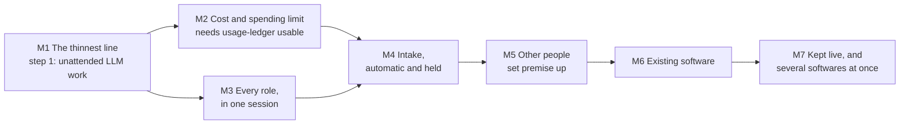

# Roadmap

The milestones in order, carved from section 8 of the plan, and the build order agreed with the owner. No dates are given. **Nothing starts until the owner says to start** ([0061](../decisions/0061-nothing-built-until-the-owner-says.md)).

The vision states the vision only, with no now-or-later split ([0035](../decisions/0035-the-vision-states-the-vision-only.md)). The order is kept here.

## Build order agreed with the owner

- Nothing is built until the owner says to start ([0061](../decisions/0061-nothing-built-until-the-owner-says.md)).
- First proof: the thinnest line, end to end, for any small software ([0034](../decisions/0034-first-proof-new-software.md), [0049](../decisions/0049-any-kind-of-software.md)). Its first step proves that premise can drive LLM work unattended through the owner's subscription; if that cannot be proven, work stops for the owner there.
- The first software is the owner's pick, made when the owner wants; building premise does not wait for it ([0050](../decisions/0050-first-software-is-the-owners-pick.md), [0060](../decisions/0060-first-software-does-not-hold-up-premise.md)).
- Cost tracking and the spending limit come when usage-ledger is usable ([0064](../decisions/0064-cost-and-spending-limit-from-usage-ledger.md)).
- Existing software after the line works ([0034](../decisions/0034-first-proof-new-software.md)).
- Other people setting premise up comes sooner than the other later items ([0033](../decisions/0033-answers-to-the-ten-assumptions.md), item 7; [0043](../decisions/0043-runs-on-the-owners-machine-first.md)).
- Later: keeping software live for real users; several softwares at once; model providers other than Claude ([0046](../decisions/0046-claude-through-the-owners-subscription.md)). Finding out whether real people want the software is out of the vision, with an active version at most a later idea ([0036](../decisions/0036-finding-out-if-people-want-it-is-out.md)).

If usage-ledger is not usable when milestone 1 ends, milestone 3 goes first and milestone 2 starts when it is.

## For every milestone

- Nothing starts until the owner says to start ([0061](../decisions/0061-nothing-built-until-the-owner-says.md)).
- Changes to premise ship as pull requests the assistant merges ([0052](../decisions/0052-fast-i-merge-reconfirmed.md)). Work stops for the owner only on destructive, security-sensitive, public-facing or money-spending actions ([0053](../decisions/0053-when-work-stops-for-the-owner.md)).
- "Shown running" means a recorded run with its evidence kept: transcripts, the record files, commits with their traces, the check's verdicts, screenshots or command output.
- "Reported" means one short report to the owner when the milestone finishes ([0054](../decisions/0054-reports-to-the-owner.md)): what was built; how it was shown running, with the evidence; what failed and what could not be checked; the builders' choices made or changed (decision records); from milestone 2 on, the cost. Anything that needs the owner is sent at once.
- [0108](../decisions/0108-scripted-operator-for-demos.md) (P42): demos use a scripted operator: answers written down before the run and fed in by a test script.
  - Why: the line runs end to end unattended, the same way each time, without spending the owner's attention ([0027](../decisions/0027-spend-least-of-peoples-attention.md)).
  - Rejected: an LLM playing the operator (it tends to agree with premise's drafts, which would hide mismatches).
- [0109](../decisions/0109-vitest-and-kept-demos.md) (P43): premise's own tests: unit tests with Vitest, and each milestone's demo kept in this repository as a scripted end-to-end run that can be run again.
  - Why: the demos are the proof that the line works; keeping them lets every later change be checked against them.
  - Rejected: unit tests only.

## Milestone 1: the thinnest line, end to end, for any small software

Thinnest means: one software at a time; only the operator; no taste claims; intake only from the operator's chat; no cost figures.

**Step 1: prove that premise can drive LLM work unattended through the owner's Claude subscription, on the owner's machine.**
- Built: a small TypeScript program, the start of the agent runner. On the owner's machine it must show each of these:
  1. It starts Claude Code headless as a child process, logged in with the owner's subscription in premise's own configuration folder, with no API key anywhere in its environment.
  2. The session finishes a multi-step coding task (write a tiny program, test it, commit it) with nobody answering anything. Whatever would need permission is denied and reported, not waited on.
  3. Confinement holds: the agent cannot write outside its working copy, cannot read a file planted in premise's data folder or the GitHub login, and cannot reach a host that is not allowed.
  4. Two sessions run at once, as a builder and a checker, and neither can read the other's files.
  5. Each session's id is recorded against the task it did, so usage can be attributed later.
  6. The subscription's usage limit is handled: rate-limit events pause the work, and it resumes after the reset. If the limit cannot be reached safely, the pause is shown with a simulated event.
  7. The server, not an agent, creates a private repository on the owner's GitHub and pushes to it.
  8. The use stays within [0103](../decisions/0103-subscription-only-for-the-owner.md) (P37): Anthropic's own Claude Code, the owner's login, the owner's machine, the owner's own use.
- **If point 1, 2, 7 or 8 cannot be proven, work stops for the owner there.** The report says what failed and what the options are, for example an API key, which spends money. Nothing else in milestone 1 starts.
- If point 3 or 4 fails, agents run in a container per session instead ([0087](../decisions/0087-agents-run-confined.md)). That makes Docker a prerequisite, which the report names. If Docker is not available, work stops for the owner, because running agents unconfined is security-sensitive.
- Shown running: the program's log, the task's commits, the confinement tests' output, the session records.
- Reported: each of the eight points, passed or failed, with its evidence.

**Step 2 onward: the line.**
- Built:
  - the server; the page (one session: chat, record view, report view, "needed"); the session's link and token; the database; the work queue that survives a restart; the gate;
  - stages Why to Plan in their thinnest form: one draft per stage, corrections in chat, a strike-out say-back, a short look at what exists;
  - the record keeper writing `premise/` files with IDs into a new repository per software; trace trailers enforced;
  - one builder and one checker, confined; the checker's scenarios out of the builder's reach; verdicts with evidence;
  - the server's merge and push; the runner, with a link or a command on the page;
  - a report each time a change reaches running; things the operator says become intake that goes in normally.
- Shown running:
  - [0110](../decisions/0110-two-sample-softwares.md) (P44): two small softwares of different kinds, each taken from a one-paragraph idea to running software with a scripted operator: a command-line utility and a small web app.
    - Why: two kinds keep the line from fitting one kind ([0049](../decisions/0049-any-kind-of-software.md)).
    - Rejected: one sample; waiting for the owner's pick ([0060](../decisions/0060-first-software-does-not-hold-up-premise.md)).
  - In each run, one assumption is struck in the say-back and the record changes to match.
  - In each run, the checker catches a defect planted in the build that it was not told about.
  - After this, the owner can run their own first pick whenever they want ([0060](../decisions/0060-first-software-does-not-hold-up-premise.md)).
- Reported: the milestone report, and for each sample what failed and what could not be checked.

## Milestone 2: cost and the spending limit, through usage-ledger

- **Prerequisite: usage-ledger is usable.** Building it is its own project, not premise work ([0064](../decisions/0064-cost-and-spending-limit-from-usage-ledger.md)). If it is not usable when milestone 1 ends, milestone 3 goes first and this one starts when it is.
- Built: premise's part of [models and cost](../architecture/models-and-cost.md#cost-and-the-spending-limit-0016-0048-0064): session-to-task records in usage-ledger's format; usage per software, stage, change and record item in reports; per-software budgets set in usage-ledger; pausing a software's queue and telling the operator when its budget is overrun.
- Shown running: milestone 1's demos run again, with usage per stage and per item in their reports; a deliberately small budget overrun that pauses the software and tells the operator.
- Reported: as for every milestone, plus what milestone 1's demos cost.

## Milestone 3: every role, in one session

- Built: roles as labels on every ask; questions in each role's terms; taste claims and proposals before building; the gate asking under the right role; approvals for a kind of action; the "needed" list grouped by role. All in the one session ([0065](../decisions/0065-one-open-session.md)).
- Shown running: a scripted run in one session that answers the asks of three roles, each ask labelled with its role:
  - the operator;
  - a role that claimed the look of the main screen;
  - a role that must do a real-world act, such as creating an account with an outside service.
- Reported: as for every milestone, plus how many questions each role was asked.

## Milestone 4: intake, automatic and held

- Built: intake from every source; triage; the in-normally, asked, held, and merged-or-closed routes; readings; the way back to Why; telling senders where their item stands.
- Shown running: planted items against a running demo software:
  - bugs fixed through the line;
  - a wish that changes purpose, asked of the operator;
  - opinions held and read together into a short list;
  - duplicates merged and noise closed.
- Reported: as for every milestone, plus counts per route.
- After this milestone the line works ([0034](../decisions/0034-first-proof-new-software.md)).

## Milestone 5: other people set premise up

Sooner than the other later items ([0033](../decisions/0033-answers-to-the-ten-assumptions.md), item 7; [0043](../decisions/0043-runs-on-the-owners-machine-first.md)).
- Built:
  - one install command, and a setup check that names what is missing;
  - each person's own model access ([0103](../decisions/0103-subscription-only-for-the-owner.md)); other providers if needed ([0107](../decisions/0107-one-part-knows-the-runtime.md));
  - setup instructions, written as part of what users read;
  - premise hosted in a container on a host its operator chooses;
  - accounts, decided at this milestone ([0045](../decisions/0045-a-link-per-person-no-accounts.md)).
- Being reached from other machines is security-sensitive ([0053](../decisions/0053-when-work-stops-for-the-owner.md), [0065](../decisions/0065-one-open-session.md)). This milestone prepares it and does not decide it: every step that exposes premise beyond one machine waits for the person running it; for the owner's own setup, the owner.
- Shown running: a clean machine (a fresh virtual machine) set up from the instructions alone, then milestone 1's demos run on it. Using an API key for this spends money, so it waits for the owner.
- Reported: as for every milestone, plus every point where setup needed a person.

## Milestone 6: existing software

- Built: [existing software](../architecture/the-line.md#existing-software-milestone-6).
- Shown running: one demo software taken on with its `premise/` folder removed, so the recovered record can be compared with the original; then one public open-source project.
- Reported: as for every milestone, plus how much of the original record was recovered, and what people were asked.

## Milestone 7: kept live, and several softwares at once

- Built: running software for its real users on hosts the operator approves; keeping it up; incidents back as intake; several softwares at once, sharing the work queue fairly, with a report per software and one summary.
- Every first deployment to a public host is public-facing and may spend money, so it is asked ([0100](../decisions/0100-floor-actions.md)).
- Shown running: two softwares live on approved hosts, one taking an incident back through the line.
- Reported: as for every milestone.

## Not on the roadmap

- **Not the product's job** ([VISION.md](../../VISION.md#what-the-product-does-not-do)): acting in the real world (opening accounts, paying, signing; premise names the person and exactly what is needed); selling or supporting the software; finding out on its own whether real people want the software ([0033](../decisions/0033-answers-to-the-ten-assumptions.md), [0036](../decisions/0036-finding-out-if-people-want-it-is-out.md)).
- **Model providers other than Claude:** later ([0046](../decisions/0046-claude-through-the-owners-subscription.md)); the agent runner is the one part that changes ([0107](../decisions/0107-one-part-knows-the-runtime.md)).
- **Being reached from other machines:** a later, security-sensitive decision for the owner ([0065](../decisions/0065-one-open-session.md), [0079](../decisions/0079-localhost-only.md)).
- **Email or chat notices:** rejected for now ([0099](../decisions/0099-notices-in-the-session.md)).
- What is still open is in [open questions](../open-questions.md).
