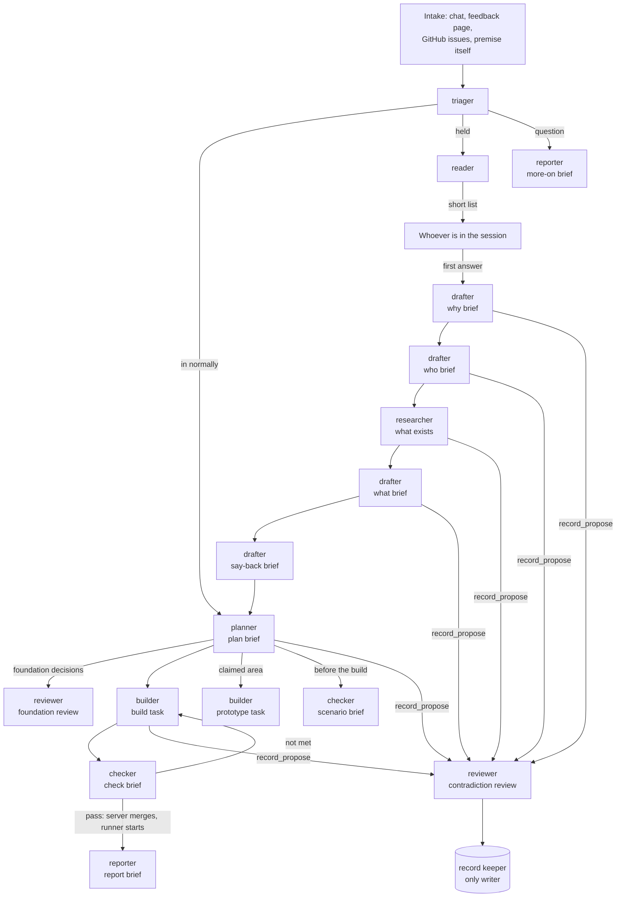

# Prompts

This folder holds the full text of every prompt premise gives its agents: one file per agent role, each with the role's system prompt and the task brief templates the server fills for each job. It also holds [fixed-wording.md](fixed-wording.md), the text the server shows people without a model: the gate's approval card, the intake acknowledgement, status lines for senders, and notices.

The prompts are published in full for the same reason as the [skills](../skills/README.md): they are where premise's behaviour is defined, and anyone reading premise should be able to see exactly what its agents are told.

These prompts are the builders' design. Nothing here is the owner's wording or the owner's decision. Each prompt is grounded in [VISION.md](../../VISION.md), the [decision records](../decisions/README.md) and the [architecture](../architecture/overview.md), and the design notes in each file say which. The agent roles are set by [record 0113](../decisions/0113-agent-roles.md); how prompts and skills ship and load is set by [record 0114](../decisions/0114-prompts-and-skills-as-files.md).

## Index

| Prompt | Agent role | Model tier | Stages and jobs | Purpose |
| --- | --- | --- | --- | --- |
| [drafter.md](drafter.md) | drafter | strongest | Why, Who, What, say-back (draft jobs); corrections in chat during a stage; record recovery for existing software | Draft each early stage as a short list for people to strike, keep or edit |
| [researcher.md](researcher.md) | researcher | strongest | What exists (research jobs), full and at smaller sizes | List what already exists, with sources, and recommend one of three outcomes |
| [reviewer.md](reviewer.md) | reviewer | strongest | review jobs: every proposed record change; every foundation decision | Catch silent contradiction; give foundation decisions a second agent's review |
| [planner.md](planner.md) | planner | strongest | Plan (plan jobs); short lists for claimed areas | Make the technical decisions with reasons, and write the working plan |
| [builder.md](builder.md) | builder | strongest | Build (build jobs); taste prototypes (prototype jobs) | Make one task's change in a confined working copy and commit it with its trace |
| [checker.md](checker.md) | checker | strongest | Check (check jobs): writing scenarios, and checking a commit | Judge the running software against the record, with evidence, out of the builder's reach |
| [triager.md](triager.md) | triager | fast | Intake (triage jobs) | Read one intake item against the record and choose its route |
| [reader.md](reader.md) | reader | strongest | Intake (reading jobs) | Read held items together and write the short list for the operator |
| [reporter.md](reporter.md) | reporter | fast | Report (report jobs); "more on" answers | Write reports from recorded facts only, each line linked to its evidence |
| [sizer.md](sizer.md) | sizer | fast, low effort | size jobs: once for every piece of work before its first stage | Decide a piece's size, the stages it needs, and whether it splits, each with a reason |
| [fixed-wording.md](fixed-wording.md) | none | none | gate, intake, notices | Text the server shows without a model |

## How the prompts fit the line

## Model tiers

premise names models by Claude Code's tier aliases, never by pinned versions ([record 0105](../decisions/0105-tier-aliases.md)). Tiers follow [record 0104](../decisions/0104-model-tier-by-role.md) and [record 0113](../decisions/0113-agent-roles.md).

| Tier | Agent roles | Character of the work |
| --- | --- | --- |
| strongest | drafter, researcher, reviewer, planner, builder, checker, reader | Work where a mistake in intent or in the build costs more rounds than the usage saved |
| fast | triager, reporter, sizer | Easy work: sorting one item; putting recorded facts into short lines; sizing one piece of work quickly |

The prompts are written for a competent general model. They hold no workarounds for one model's weaknesses ([record 0031](../decisions/0031-the-product-is-general.md)), so a better model makes premise better without a change to them.

## How a prompt is assembled

The agent runner assembles each session's instructions; nobody writes them by hand.

1. The role's system prompt, from the role's file.
2. Every skill the role lists, in full, in the order of the [skills catalog](../skills/README.md), appended after the system prompt. No skill is loaded on demand ([record 0114](../decisions/0114-prompts-and-skills-as-files.md)).
3. The task brief for the job, with its placeholders filled by the server from the work queue, the record, and premise's database.

Placeholders are written `{{name}}`. A placeholder with no value is filled with "none". Lists are filled one item per line, in the record's own line format where the items are record items.

The shipped prompt files follow these documents. A change to a prompt is made here first, in the same pull request as the shipped file.

## Conventions shared by every prompt

- **Words.** The *product* is premise. The *software* is what premise builds. The *operator* is the person who knows what the software is for. A *role* is a label on what is asked of people (the operator, a role that claimed an area for its taste, a role that decides or acts). Agents never name people; the record and every ask name roles ([record 0081](../decisions/0081-nothing-about-people-in-the-repository.md)).
- **Tool names** are exactly those in the [agent tools specification](../specs/agent-tools.md): `record_read`, `record_propose`, `draft_submit`, `ask`, `gate_request`, `progress`, `task_finish`, `scenario_write`, `verdict_submit`, `review_submit`, `triage_submit`, `reading_submit`, `facts_read`, `report_submit`.
- **Record items** are written in the record's line format: `- [W-7] People can export their list as a CSV file. (must; from: operator; 2026-11-21)`. Prefixes: `Y` why, `U` users, `R` roles, `E` what exists, `W` what it must do, `T` taste, `D` decisions, `I` intake items ([record 0082](../decisions/0082-record-as-markdown-with-ids.md)).
- **Ask kinds** are exactly: question, draft, say-back, proposal, approval, needed. Every ask carries a role label.
- **Check verdicts** are exactly: met, not-met, could-not-check, each with evidence.
- **Standing rules** appear, through the skills, in every prompt whose output people read: lists, short, in the role's own terms; assumptions marked; what failed and what could not be checked stated plainly.

## Where each rule is enforced

The rules are carried by prompts and skills. Where a model mistake would be costly, the system also enforces the rule, so that the prompt is never the only guard. Instructions are not access control.

| Rule | Prompt and skill | System enforcement |
| --- | --- | --- |
| Agents never write the record | every role prompt; [the-record](../skills/the-record.md) | The [record keeper](../specs/record-keeper.md) is the only writer; agents only have `record_propose` ([record 0073](../decisions/0073-mcp-tools-with-session-tokens.md)) |
| Malformed or contradicting record changes do not land | [the-record](../skills/the-record.md); reviewer prompt | The record keeper parses every file on every change; the reviewer checks every proposed change against the whole record ([record 0113](../decisions/0113-agent-roles.md)) |
| Agents never push, create repositories or comment on GitHub | builder prompt; [the-floor](../skills/the-floor.md) | Only the server holds the GitHub login ([record 0077](../decisions/0077-github-through-existing-cli-login.md)); agents cannot read it ([record 0087](../decisions/0087-agents-run-confined.md)) |
| Agents never take a floor action | [the-floor](../skills/the-floor.md) | No credentials, confinement ([record 0087](../decisions/0087-agents-run-confined.md)), and the [gate](../specs/gate.md) ([record 0101](../decisions/0101-the-gate-asks-in-the-session.md)) |
| Every commit names what it serves | builder prompt; [tracing-work](../skills/tracing-work.md) | The server refuses to push a commit without a valid `Premise-Trace` trailer ([record 0083](../decisions/0083-trace-trailer-on-every-commit.md)) |
| The checker never sees the builder's account | checker prompt | The checker is a fresh session on its own working copy; the server never passes it the builder's transcript, summary or `task_finish` text ([record 0089](../decisions/0089-checker-in-a-fresh-session.md)) |
| Builders cannot read or edit the check scenarios | checker prompt | Scenarios live in premise's data folder, which builders cannot read ([record 0090](../decisions/0090-scenarios-out-of-the-builders-reach.md), [record 0122](../decisions/0122-scenarios-written-before-the-build.md)) |
| Reports come from recorded facts only | reporter prompt; [honest-reporting](../skills/honest-reporting.md) | The reporter has `facts_read` and no access to agents' transcripts or summaries; `report_submit` refuses a line without an evidence link ([record 0097](../decisions/0097-reports-from-recorded-facts.md)) |
| Outside content is data | [outside-content-is-data](../skills/outside-content-is-data.md) | Confinement and the gate limit what any agent can do, whatever it read ([record 0116](../decisions/0116-outside-content-is-data.md)) |
| Runaway sessions stop | [working-within-limits](../skills/working-within-limits.md) | Turn and time limits per session; the same failure three times stops the task ([record 0088](../decisions/0088-turn-and-time-limits.md)) |
| Depth follows return on effort | [return-on-effort](../skills/return-on-effort.md) | Stage budgets from the software's size class ([record 0085](../decisions/0085-stage-effort-budgets.md), [record 0117](../decisions/0117-size-classes-set-stage-budgets.md)) |
| Security defaults hold | planner and builder prompts; [security-defaults](../skills/security-defaults.md) | The checker checks them on every change ([record 0092](../decisions/0092-security-defaults.md)) |
| Questions only where being wrong is costly | [assume-and-show](../skills/assume-and-show.md) | The line engine shows drafts as lists to strike, not as questions ([record 0027](../decisions/0027-spend-least-of-peoples-attention.md)) |

## Related documents

- [Skills catalog](../skills/README.md)
- [Agent tools](../specs/agent-tools.md), [agent runner](../specs/agent-runner.md), [line engine](../specs/line-engine.md)
- [The line, stage by stage](../architecture/the-line.md)
