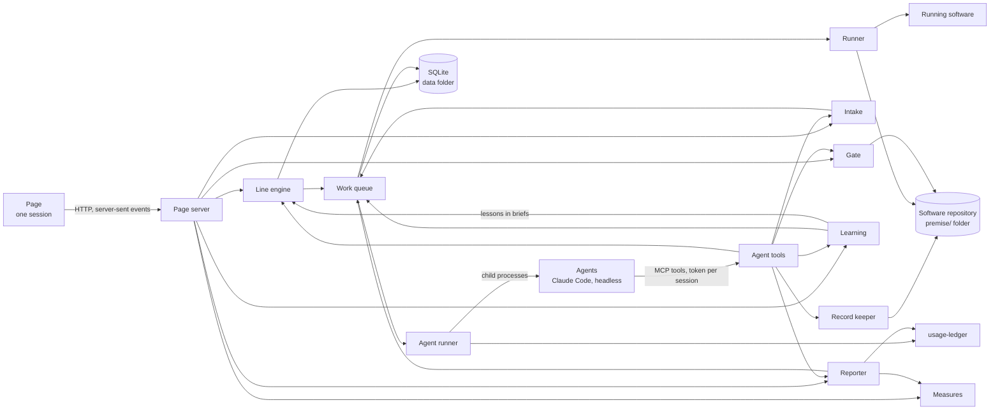

# Module specifications

This folder specifies every module of premise in enough detail to build it without a further design conversation. The specifications describe behaviour, interfaces, data, limits and failure handling in lists and tables; they contain no code. They sit below the [architecture overview](../architecture/overview.md), which explains how the parts fit together, and the [decision records](../decisions/README.md), which explain why.

The build has started ([0130](../decisions/0130-the-build-starts-and-covers-all-of-premise.md)); these specifications are what the builders build from. Settings are listed in the [configuration reference](../reference/configuration.md), generated from the code.

## How to read these documents

- **The owner, or anyone deciding** can read section 1 (Purpose) and section 11 (Milestones) of each specification to see what will be built and when. What remains open is in [open questions](../open-questions.md).
- **Builders** should start with the [architecture overview](../architecture/overview.md) and [the line](../architecture/the-line.md), then read [storage](storage.md) and [agent tools](agent-tools.md), which every other specification refers to.

Every module specification uses the same sections: purpose; responsibilities and non-responsibilities; interfaces; data owned; behaviour; configuration; limits; failure modes and recovery; security considerations; observability; milestones.

## Conventions used throughout

- **Choices are stated as decided.** Each rests on the [vision](../../VISION.md) and the decision records, cited by number. The owner made the records 0001–0066; the builders made the rest, each with its reason and the alternative rejected. Nothing in a specification is the owner's unless a record says so.
- **Details are the builders'.** Table columns, field names, routes, error codes and default values are below the level of a decision record. They are starting values, tuned on milestone 1's demos, and can change with the specification. A change to what people see, what the record holds, or how safety works needs a new decision record.
- **Defaults.** Every limit, budget, interval and count here is a default in a configuration table.
- **Shared shapes.** Database tables are defined once in [storage](storage.md). Agent tools, their inputs, outputs and errors are defined once in [agent tools](agent-tools.md); the [prompts](../prompts/README.md) use exactly those names.
- **Words.** The **product** is premise; the **software** is what premise builds; the **operator** is the person who knows what a software is for; a **role** is a label on what is asked of people; an **agent role** is the kind of agent session (drafter, researcher, reviewer, planner, builder, checker, triager, reader, reporter; [0113](../decisions/0113-agent-roles.md)). See the [glossary](../glossary.md).

## Index

| Specification | Module | What it covers |
|---|---|---|
| [page-server.md](page-server.md) | Page server | The one server process's front: the start command, the prerequisite check, the session's link and token, Host and Origin checks, localhost only, the HTTP API, server-sent events, feedback pages. |
| [page.md](page.md) | The page | One session where everything is open: chat, every stage, the record view, the report view, "needed" by role, approvals, taste claims and proposals, notices. |
| [line-engine.md](line-engine.md) | Line engine | Where each software is on the line; the eleven stages and their exit conditions; role labels; who has the last word; stage budgets and size classes; the say-back; taste; check outcomes; chat routing; existing software. |
| [record-keeper.md](record-keeper.md) | Record keeper | The only writer of each software's lasting record: files, line format, IDs, replacing and striking, the contradiction check, trace trailers. |
| [work-queue.md](work-queue.md) | Work queue | Jobs stored to survive a restart; two agent sessions at once; the three-strike rule; pausing for the usage limit and for budget overruns. |
| [agent-runner.md](agent-runner.md) | Agent runner | Starting, confining, limiting and stopping agent sessions; prompts and skills; model tiers; session records for usage-ledger; milestone 1's first step. |
| [agent-tools.md](agent-tools.md) | Agent tools | Every tool premise serves to agents over MCP, by agent role, with inputs, outputs and errors. |
| [gate.md](gate.md) | Gate | Floor actions; asking in the session under the right role; approvals for one action or a kind; the server performing the act. |
| [runner.md](runner.md) | Runner | Creating repositories; merging and pushing after a pass; starting the software from a clean copy; restarts; logs; release notes; what an LLM cannot provide. |
| [intake.md](intake.md) | Intake | Sources; triage; routes; what is held; readings; the way back to Why; telling senders. |
| [reporter.md](reporter.md) | Reporter | Reports from recorded facts only; the report view; when reports are written; notices; more detail; cost through usage-ledger; release notes. |
| [measures.md](measures.md) | Measures | premise's own return from recorded events: attention, time to answer, idea to running, problem to fix, things reported working that came back as bugs, sessions per change; "not enough yet". |
| [learning.md](learning.md) | Learning | Learning from corrections, in two kinds kept apart: lessons for a software and the operator's taste, which agents follow; improvements for premise itself, which never change it. |
| [usage-ledger.md](usage-ledger.md) | usage-ledger contract | What premise records for every agent session, and what usage-ledger must answer: usage by stage, change and record item; budgets; overruns; the mock. |
| [usage.md](usage.md) | Usage and budgets | Usage shown per software, phase, step, change and item, mocked figures labelled beside premise's own counts; per-software budgets; pausing on an overrun and the operator's three answers. |
| [storage.md](storage.md) | Storage | What lives in the database, the data folder and each software's repository; every table. |

## Module map

Only the server writes the record, pushes, creates repositories and holds credentials. Agents reach premise only through their tools, and run confined.

## Related documents

- Product: [vision](../../VISION.md), [scope](../product/scope.md), [roles and use cases](../product/roles-and-use-cases.md), [roadmap](../product/roadmap.md).
- Architecture: [overview](../architecture/overview.md), [where it runs](../architecture/where-it-runs.md), [the record](../architecture/the-record.md), [the line](../architecture/the-line.md), [build, check and run](../architecture/build-check-run.md), [intake and reporting](../architecture/intake-and-reporting.md), [the floor and the gate](../architecture/the-floor-and-the-gate.md), [models and cost](../architecture/models-and-cost.md).
- Agent behaviour: [prompts](../prompts/README.md), [skills](../skills/README.md).
- Terms: [glossary](../glossary.md).
